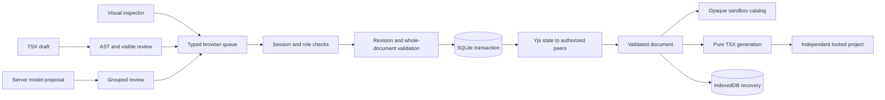

# Implemented architecture — updated 15 October 2026

**18 October runtime extension:** [Cloudflare architecture and deployment](CLOUDFLARE.md) documents the additional actual Worker/SQLite Durable Object/WebSocket implementation, shared StoreCore, pure bundled export and Workers AI adapter. The native architecture below remains supported. The core application is live on Workers Free; [acceptance evidence and remaining limits](CLOUDFLARE_VERIFICATION.md) distinguish native fixtures, actual workerd checks and public execution.

Independent application source; the existing portfolio is a separate project. React19.3/Vite8 SPA, Node24.13 Express5 HTTP/WebSocket service, built-in experimental SQLite. Vite middleware in development; same service serves dist plus public screenshot/assets in production. Installed versions: docs/DEPENDENCIES.md.

## Modules and ownership

- src/core: typed schema-v1 normalized IR; catalog allowlists, deterministic serialization/v0 migration, whole-document validation, atomic operations, token graph and diagnostics/preconditions. Stable node IDs, one reachable Frame root, ordered children/no cycles or orphans, JSON props/bindings/events. Limits2,000nodes/100operations per batch/bounded scalar fields.
- src/compiler: pure generateDocument emits validated IR; Babel AST importer/strict compileDocument wrapper reads only supported managed TSX. Locations identify nodes/code lines. Exact outside strings are preserved as nonexecuted source; editor input line endings may normalize. docs/SUPPORTED_CODE.md is syntax contract.
- src/runtime: shared catalog, safe state/events/conditions, local abortable fictional-ticket connector, filters/forms/selection/assignment/load/error/empty/retry/activity. Responsive effective layouts and primitive/semantic color+numeric aliases. Application state is distinct from Studio design state; no live customer connector.
- src/editor: layer/palette/canvas/inspector/CodeMirror/review/history/presence/share/AI UI, IndexedDB snapshots/offline queues/drafts, sandbox preview. Initial design emits code through pure generator; AST and CodeMirror load on demand. Saved outside regions are AST-reviewed on recovery; corrupt drafts remain recoverable.
- server: Store owns SQLite users/session hashes/projects/members/invites/history/immutable versions; SyncEngine validates ordered typed operations before persisting canonical+causalYjs state. Express/WS enforce session, origin, membership and roles. docs/COLLABORATION.md details conflicts/undo/reconnect/deletion.
- Server capacity: server/limits.ts normalizes strict immutable policy/environment values. Store schema2 additively adds ai_usage with one mutable UTC-day bucket per user/global scope; no prompt/request content is stored. Logical database pages and project/owner/version/history caps reject writes without pruning. Demo/join identity/session changes share the project/membership transaction. Authorized AI requests reserve persistent allowances and acquire a process-local concurrency gate; authorized WebSocket upgrades check live total/user capacity before materializing CRDT state. See [DEMO_LIMITS](DEMO_LIMITS.md). Application documents remain schema1.
- server/ai: explicit environment provider/model adapter, minimized context, strict structured operation proposals, timeout/cancel/zero-retry handling, dependency-aware subset validation. No automatic application. Workers AI has controlled real-model evidence; the optional native provider remains unverified live.
- src/export: validated fresh TSX plus copied runtime/core source/tokens/assets/deps/pruned exact lockfile and README; custom source text separate. scripts/verify-export.ts checks actual ZIP/file bytes and clean independent installation/build/browser.
- src/portfolio: public case study, actual captures under docs/screenshots. Passive page creates no session/API/WS traffic until Studio CTA. Source and narrative are published on GitHub; the full Cloudflare backend is publicly hosted with persistent SQLite and native WebSockets.

Module changes should preserve shared contracts and be verified through integration tests.

## Data flows

Visual edits → typed operation envelope → optimistic queued browser document → authenticated server validation/revision order → SQLite transaction +Yjs update → all authorized clients → shared preview/compiler. Offline replay compares touched-field fingerprints; structural/code/AI application requires exact base. Code draft → AST diagnostics + visible semantic diff → explicit replace operation. AI instruction/minimized context → provider → validated operation groups → review/explicit application. docs/CONTRACTS.md is authoritative alongside types.ts.

## Persistence and trust

Server startup rejects future/corrupt/incompatible snapshots/causal state while retaining originals. Browser retains invalid/incompatible code/offline records for download; explicit discard archives source. Field-conditional actor undo protects unrelated changes; immutable version restore is inspected and creates a new revision. Browser reload/server restart and adversarial HTTP/WS cases have local evidence in VERIFICATION; host operations remain unverified.

Preview renders only validated IR through trusted catalog code in iframe sandbox=allow-scripts (opaque origin). postMessage verifies sender/channel/type/payload. No cookies/API keys/imported executable code enter preview. Public built assets permit opaque-origin loading; protected APIs have no public CORS header. Exported applications do not depend on Studio privileges. Sessions are HttpOnly/SameSite/secure on configured HTTPS; pseudonymous demo identity is not verified-account recovery. One writable server process/local SQLite; no distributed deployment implemented.

Capacity refusals preserve existing documents/history/versions and use actionable errors. SQLite_FULL handling preserves automatic rollback errors; a failed candidate Yjs state never replaces the canonical room. There is no automatic retention deletion. The main-database page cap is not a whole-disk/WAL/CPU quota, and AI attempt limits do not guarantee a monetary spend. Non-loopback startup requires an exact explicit origin; HTTPS/proxy/volume/ingress configuration remains host-specific.

## Planned boundaries

Real-provider inference/schema acceptance/model quality/live cancellation/revocation review awaits private configuration. Future extensions: real data connectors, broader carefully contracted code/catalog support, verified-account identity/account recovery, host-specific operational/retention policy and user research. These extensions are not described as implemented. Architecture diagram and all current acceptance evidence live in docs/CASE_STUDY.md and [VERIFICATION](VERIFICATION.md).
