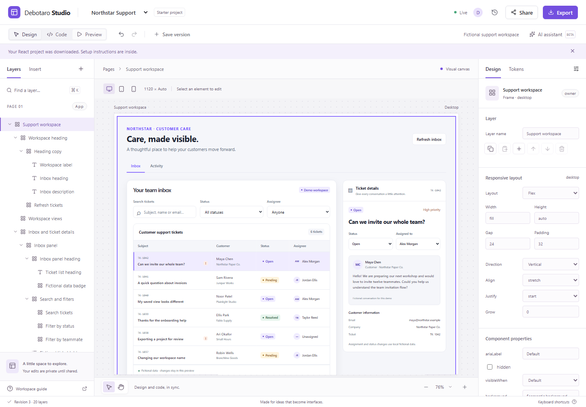
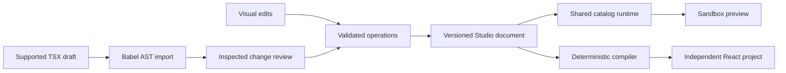

# Debotaro Studio — a shared canvas, a working system

**Independent product / Design engineering / Working local prototype**
Evidence checkpoint: 14 October 2026. Public implementation scope and current checks: [verification](VERIFICATION.md) and [architecture](ARCHITECTURE.md).

Captured from the actual running local product with fictional data. Public-page captures: [desktop](screenshots/case-study-desktop.png), [phone](screenshots/case-study-phone.png).

## Intent

Debotaro Studio explores a specific problem: a visual interface decision and its React implementation often need to be understood in separate places. A supported change in either place should have a clear route back to the same application.

The initial audience is designers and frontend developers building customer-support workspaces. This is a product hypothesis from Debotaro’s brief, not a conclusion from completed user research. A concrete fictional inbox makes the idea testable: search, status/assignee filters, ticket detail, assignment and local state changes.

The project supports Design Engineer and technically focused Product Designer applications by making interaction decisions, system boundaries, source and verification inspectable. It is an independent product inspired by professional creation-tool workflows; it is not affiliated with Figma.

## Contribution and process

Debotaro supplied product direction, target audience, requirements, visual goals and the commitment to preserve the complete scope. Implementation was developed with Codex, using documented requirements, explicit contracts, scoped implementation tasks and integration review.

AI-assisted engineering is part of the authorship story. This case study does not imply that Debotaro manually wrote every line, completed user interviews or launched the product. Source, decisions and actual test evidence are available for inspection.

## Experience

The editor combines a project toolbar, palette/layers, canvas, inspector, code editor and responsive preview. A neutral shell with a restrained violet accent keeps the application content prominent. The application’s theme is independent from the editor’s theme.

The starter is a functioning fictional support workspace, not a static mockup. Search and filters change its ticket list. Selecting a row opens customer details; assignment/status changes appear in local activity. Loading, empty/error/retry and form-validation paths are part of the shared runtime. Real customer connections are future extensions of a connector interface.

Keyboard selection and layer controls provide alternatives to canvas gestures. Small-screen panels focus on one task at a time. Diagnostics flag labels and supported contrast cases; they are not accessibility certification.

Independent export desktop/phone screenshots were captured and inspected during local verification; raw test artifacts are not part of this public source snapshot. The actual editor and public case-study captures are included under docs/screenshots. The /case-study page passed three scoped Playwright checks on desktop1440px and phone390px: actual image loading, content, keyboard skip/anchors/CTA, visible focus, reduced motion, no page overflow and no console errors. Reading the case study makes no application API requests or collaboration connection and creates no Studio session. The page’s fallback system diagram is explicitly a diagram, never presented as a screenshot.

## The document is the connection

A versioned intermediate representation holds a normalized tree with stable node IDs, catalog properties, flex/grid layout, responsive overrides, tokens, safe bindings and declarative events. Transactions validate the complete result before advancing its revision. Schema migration and deterministic serialization support persistence and recovery.

The AST importer accepts a deliberately documented TSX subset. It reads JSON-compatible literals and catalog JSX, preserving identities and meaning rather than equating formatting with semantics. Unsupported managed syntax is refused before application. Outside handwritten source remains byte-for-byte recoverable and is exported as text, excluded from executable files. Arbitrary hooks/JavaScript/custom components are outside this contract.

Invalid drafts cannot replace the last valid document. Code review applies against an exact base revision; a stale draft must be reconciled with the current workspace. Color and numeric aliases carry through preview/export, including responsive spacing/dimensions and radius/typography. Shared updates resolve through the same validated graph; invalid dependencies reject atomically. Applied outside source survives browser reload; invalid cached code stays recoverable.

## Collaboration has a server boundary

Clients submit typed operations. The Node service checks a server-issued session, project membership, revision/preconditions and document validity before writing SQLite and publishing Yjs state. Client-authored raw CRDT binary updates are refused. This trades unrestricted peer edits for validated application invariants.

Independent field changes may merge if the touched values still match their preconditions. Stale structural changes are refused for inspection. A conditional undo verifies that someone else has not changed the affected fields; structural undo is more conservative. SQLite stores documents, collaboration snapshots, permissions, history and immutable versions; IndexedDB stores recoverable drafts and pending edits.

Actual HTTP/WebSocket/SQLite tests and two rendered browser sessions cover convergence, offline reconnect/reload, actor undo, revocation, direct access, server restart and corrupt-state retention. Read the [verification summary](VERIFICATION.md) for source context. Display names are pseudonymous demo identities; verified accounts/account recovery remain future extensions.

## Shared runtime, independent result

Preview renders the validated document through trusted components in an iframe sandbox. Imported source is never evaluated in Studio. Export compiles fresh source from the valid document and copies the same runtime into a complete React/TypeScript/Vite project with exact dependencies, a transitive lockfile and setup instructions.

The independent project was installed with npm ci, typechecked, built, started and tested in a real Chromium browser. It made no Studio API requests. Search, filters, selection, assignment, status, activity, empty-state recovery and refresh preserving local changes passed. Desktop 1440×1000 and phone 390×844 screenshots were inspected; the phone document’s scrollWidth equaled its 390px viewport and visible keyboard focus was checked. Those are observations from a specific fixture/environment, not generalized performance or accessibility claims.

## AI proposes operations

The product contract puts model inference behind a server adapter with an explicit configured model. Model output proposes allowlisted operations rather than arbitrary executable code. Meaningful operation groups are reviewed before application, with dependency, permission and base-revision checks.

The real Responses adapter, HTTP acceptance flow and non-live evaluation set are implemented/tested, including numeric proposals, stale patches, dependencies, permission boundaries, cancellation and timeout fixtures. No application credentials were configured and no live inference success is claimed. Editor/export remain available. Its tested context projection excludes ticket datasets, source drafts and credentials. User-entered layer text and the request are sent; this is not a claim that all potentially sensitive text is automatically redacted.

## Evidence and limitations

At source c14adca, the final aggregate passed236 tests across18files; lint/typecheck/productionbuild and all19productionbrowser tests passed. Tests cover semantic round trips, source preservation, malformed/unsupported edits, schema diagnostics, runtime DOM interactions and export payloads. Testing caught real defects—including design-mode selection of a disabled loading button and a visible button label overridden by its layer name—and they became regressions.

Reproducible Node measurements ran on100/500/1,000-node sibling and balanced fixtures with3warmups/12samples. At verified source c14adca on Windows/Node24.13/i7-14700K, the1,000-node sibling p95 was4.549ms validation/11.141ms transaction/8.562ms generation/21.383ms AST import; balanced4.743/10.959/8.673/21.462ms. Chosen budgets100/175/1,000/1,000ms all passed. See [performance methodology and recorded results](PERFORMANCE.md). Raw local reports are not distributed.

Actual production browser editing ran all6fixtures with18warmups/72samples on Chromium156.0.8078.4/Playwright1.64.1 at1440×1000. The metric spans inspector fill+Enter to authoritative revision/text and sandbox DOM observation, including automation/network/polling; it is not intrinsic paint/input latency. Sibling100/500/1,000 p95 was33.488/98.878/149.245ms; balanced35.325/92.932/166.167ms against preselected500/750/1,000ms budgets. No browser errors; owned server stopped. See [performance methodology and recorded results](PERFORMANCE.md). Raw local reports are not distributed. Shared workstation28logical CPUs/34,114,199,552RAMbytes; no generalized performance/load claim.

The production signature journey, numeric visual/code/ZIP flow, saved-code recovery, clean independent export and reproducible browser measurements have local evidence. Live-provider schema acceptance/inference/model quality/cancellation/revocation remains blocked by absent application credentials/model; host-specific operations remain unverified. Current public verification scope is documented in [VERIFICATION](VERIFICATION.md). There is no invented adoption, business impact, usability score or novelty claim. The project does not claim arbitrary code round trips, live customer-ticket management or certified accessibility.

## Next research step

Recruit designers and frontend developers for moderated tasks: edit a support workspace, inspect/change supported TSX, invite a collaborator, recover a conflict and run an export. Observe task completion, errors, recovery and how participants explain the boundary. Ask permission to record sessions and keep participant information separate from repository fixtures.

Use findings to prioritize component/interaction contracts, code-boundary communication and conflict review. Broader syntax, real connectors and verified account identity should follow evidence from this workflow.

## Portfolio entry point

Debotaro’s GitHub.io portfolio should link to the case study and separately to a hosted Studio demo after authorized hosting. GitHub Pages can host a static narrative; the full editor needs a Node/WebSocket service and persistent SQLite storage. No external deployment has been performed. See [HOSTING](HOSTING.md) and the [signature demo](DEMO_SCRIPT.md).
